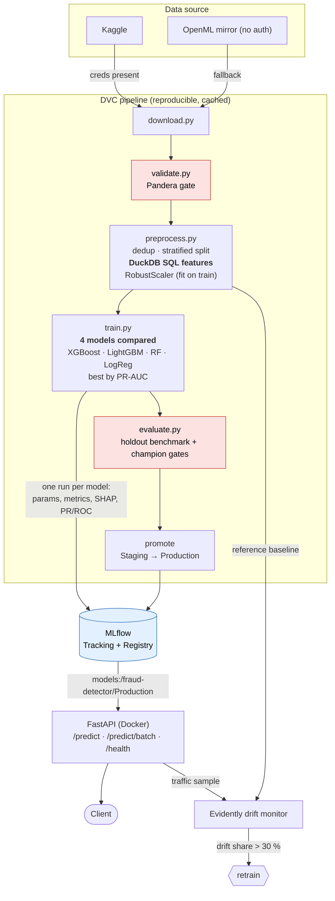
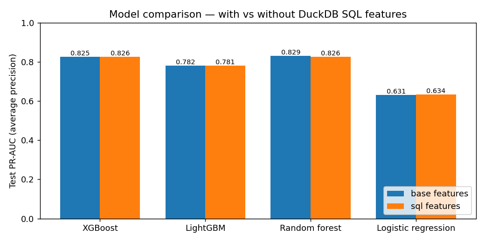

# Credit-Card Fraud Detection — from model to production

[](https://github.com/lazareaya/fraud-detection-mlops/actions/workflows/ci.yml)
[](https://github.com/lazareaya/fraud-detection-mlops/actions/workflows/quality.yml)
[](https://github.com/lazareaya/fraud-detection-mlops/actions/workflows/e2e.yml)
[](pyproject.toml)
[](LICENSE)

## The problem

Detect fraudulent card payments among **284,807 transactions** of which only
**0.17 % (492) are frauds** — a 577:1 class imbalance where accuracy is
meaningless and **PR-AUC**, recall and precision on the fraud class are what count.

## Architecture



More diagrams (DVC DAG, promotion lifecycle, serving sequence) in
[docs/architecture.md](docs/architecture.md).

## Results

4 model families × 2 feature sets, same stratified 70/15/15 split (duplicates
removed). The winner is chosen on **validation PR-AUC**; test columns are the
untouched holdout at each model's own tuned decision threshold (highest
precision with recall ≥ 0.85 on validation). Reproduce with
`python scripts/compare_feature_sets.py`.

| Model | Features | Val PR-AUC | Test PR-AUC | Test ROC-AUC | Test recall | Test precision | Test F1 |
|---|---|---|---|---|---|---|---|
| XGBoost | base | 0.865 | 0.825 | 0.972 | 0.831 | 0.584 | 0.686 |
| **XGBoost ✅ (in production)** | **+ SQL** | **0.869** | **0.826** | **0.975** | **0.831** | **0.656** | **0.733** |
| LightGBM | base | 0.845 | 0.782 | 0.969 | 0.803 | 0.606 | 0.691 |
| LightGBM | + SQL | 0.855 | 0.781 | 0.967 | 0.817 | 0.468 | 0.595 |
| Random forest | base | 0.861 | 0.829 | 0.954 | 0.817 | 0.906 | 0.859 |
| Random forest | + SQL | 0.861 | 0.826 | 0.953 | 0.817 | 0.866 | 0.841 |
| Logistic regression | base | 0.727 | 0.631 | 0.970 | 0.803 | 0.640 | 0.713 |
| Logistic regression | + SQL | 0.721 | 0.634 | 0.973 | 0.803 | 0.626 | 0.704 |



**What the numbers say**

- **XGBoost wins on validation PR-AUC** (0.869) and is the model promoted to
  Production. On the holdout it catches **83 % of frauds** with **66 % precision**
  (ROC-AUC 0.975, PR-AUC 0.826) and passes every gate in
  [evaluate.py](src/models/evaluate.py) (ROC-AUC ≥ 0.96, PR-AUC ≥ 0.80,
  recall ≥ 0.78, precision ≥ 0.60).
- **SQL features help XGBoost where it matters:** at the same recall, holdout
  precision goes **0.584 → 0.656** (+7 pts, i.e. fewer false alarms per fraud
  caught) and F1 0.686 → 0.733. Without them the model *fails* the 0.60
  precision gate. For the other families the effect is neutral or slightly
  negative: the engineered features mostly help the model that best exploits
  interactions with the hour of day.
- **Random forest is a close second** on PR-AUC with much higher precision at
  its operating point (0.87–0.91): with a business cost that penalises false
  alarms more, it would be the better pick — the selection metric is one line
  in `params.yaml`.
- **LightGBM needed a fix to be competitive:** with the default
  `min_child_weight=1e-3` and `scale_pos_weight=24`, near-empty leaves blow up and
  validation PR-AUC collapses to **0.17**; a hessian floor of 1 brings it to **0.85**.
- **Logistic regression** reaches a high ROC-AUC (0.97) but a much lower PR-AUC
  — a textbook illustration of why ROC-AUC is misleading under heavy imbalance.

## Live API

> **Live demo:** _deploy on Render (see [Deployment](#deployment)) and paste the
> public URL here_ — e.g. `https://fraud-detection-mlops-api.onrender.com/docs`

```bash
curl -X POST https://<your-service>.onrender.com/predict \
     -H "Content-Type: application/json" -d @tests/sample_transaction.json
# {"fraud_probability":0.996,"is_fraud":true,"threshold_used":0.0875,...}
```

## What I added

This project started from an MIT-licensed MLOps pipeline (see [Credits](#credits))
that trained a single XGBoost model. My contributions:

1. **Multi-model training & comparison** ([src/models/train.py](src/models/train.py)) —
   `train.model_type: xgboost | lightgbm | logreg | random_forest | auto` in
   [params.yaml](params.yaml). In `auto` mode the 4 families are trained, each
   as its **own MLflow run** (nested under a comparison run) logging PR-AUC,
   recall, precision, F1, plots, feature importances and a model artifact. The
   best by **validation PR-AUC** is automatically registered, gated on the
   holdout and **promoted to Production** (new `promote` DVC stage). The serving
   wrapper ([src/models/predict.py](src/models/predict.py)) is now
   model-agnostic, so the API serves whichever family wins.
2. **SQL feature engineering with DuckDB** ([src/data/features.py](src/data/features.py)) —
   `hour_of_day` (`Time % 86400 / 3600`), `log_amount` (`LN(1 + Amount)`) and
   `amount_vs_hour_mean`, computed with a **window function**
   `AVG(Amount) OVER (PARTITION BY hour_of_day)`. No leakage and no
   train/serve skew: the hourly means come from the training split only, are
   persisted, then joined onto validation, test and **live API requests** by
   the same SQL code.
3. **Experiment: with vs without SQL features** across all 4 models
   ([scripts/compare_feature_sets.py](scripts/compare_feature_sets.py)): the
   results table above.
4. **Deployment & CI**: Render blueprint ([render.yaml](render.yaml)) for the
   self-contained API image; CI trimmed to the workflows that run without
   secrets (lint + mypy + tests with ≥ 80 % coverage, real-data quality gate,
   e2e smoke); lockfiles and Docker images updated (LightGBM, DuckDB).
5. **Tests** for every addition ([tests/test_features.py](tests/test_features.py),
   [tests/test_train.py](tests/test_train.py)): SQL feature values, row order,
   window-vs-join parity, API feature parity, each model family, winner
   selection. **96 tests, 83 % coverage.**

## Quick start

```bash
# Python 3.11 environment
uv venv --python 3.11 && source .venv/bin/activate
uv pip install -r requirements.lock && uv pip install -e . --no-deps

# MLflow tracking server + model registry on http://localhost:5000
docker compose up -d mlflow
# (without Docker: mlflow server --backend-store-uri sqlite:///mlflow-data/mlflow.db \
#    --artifacts-destination ./mlruns --serve-artifacts --port 5000)

# Full pipeline: download -> validate -> preprocess -> train (4 models) -> evaluate -> promote
export MLFLOW_TRACKING_URI=http://localhost:5000
dvc repro

# With vs without SQL features (8 runs)
python scripts/compare_feature_sets.py

# Tests, API, drift monitoring
make test
docker compose up --build api          # http://localhost:8000/docs
python src/monitoring/detect_drift.py --simulate-drift
```

> macOS + LightGBM: install OpenMP first (`brew install libomp`).

## Deployment

The API is deployed from [Dockerfile.demo](Dockerfile.demo), a self-contained
image that downloads the public data, runs the pipeline (4-model comparison
included) **at build time** and serves the winning model: no secrets, no
tracking server, and it fits Render's free tier.

1. Create a free account on [render.com](https://render.com) and connect GitHub.
2. **New → Blueprint** → select this repository: Render reads
   [render.yaml](render.yaml), then builds and deploys the API.
3. Open `https://<service>.onrender.com/docs` (the free tier sleeps after
   15 min idle; the first request takes about a minute to wake it).

## CI/CD (GitHub Actions)

- **[ci.yml](.github/workflows/ci.yml)**: ruff, mypy, pytest with an 80 %
  coverage gate, DVC DAG validation.
- **[quality.yml](.github/workflows/quality.yml)**: trains on a real public
  dataset (OpenML, no secrets) and fails the build if the model regresses below
  its benchmark gate.
- **[e2e.yml](.github/workflows/e2e.yml)**: the whole loop on a synthetic
  profile: train → register → promote → serve → `POST /predict`.

## Stack

Python 3.11 · **SQL (DuckDB)** · pandas · scikit-learn · **XGBoost** ·
**LightGBM** · MLflow (tracking + model registry) · DVC · Pandera · SHAP ·
Evidently · FastAPI · Pydantic v2 · Docker · GitHub Actions · pytest · ruff · mypy

## Repository layout

```
src/data/        download.py · validate.py (Pandera) · features.py (DuckDB SQL) · preprocess.py
src/models/      train.py (4-model comparison, MLflow) · evaluate.py (gates) · predict.py (pyfunc)
src/monitoring/  detect_drift.py (Evidently)
api/             FastAPI app, schemas, Dockerfile
scripts/         compare_feature_sets.py · promote_model.py · e2e_smoke.py · cv_evaluate.py
docs/            architecture.md · model_comparison.md · upstream_readme.md
dvc.yaml         download → validate → preprocess → train → evaluate → promote
```

## Credits

MLOps pipeline base (DVC stages, validation, MLflow tracking, FastAPI serving,
drift monitoring, CI) taken from
**[neopentane7/mlops-fraud-detection](https://github.com/neopentane7/mlops-fraud-detection)**
(MIT License, © 2026 Abhik Kumar Mohanta). Its original README, with detailed
engineering notes, is kept in [docs/upstream_readme.md](docs/upstream_readme.md).
Dataset: [ULB Machine Learning Group, Credit Card Fraud Detection](https://www.kaggle.com/datasets/mlg-ulb/creditcardfraud).

## License

[MIT](LICENSE). The original copyright notice is preserved.
