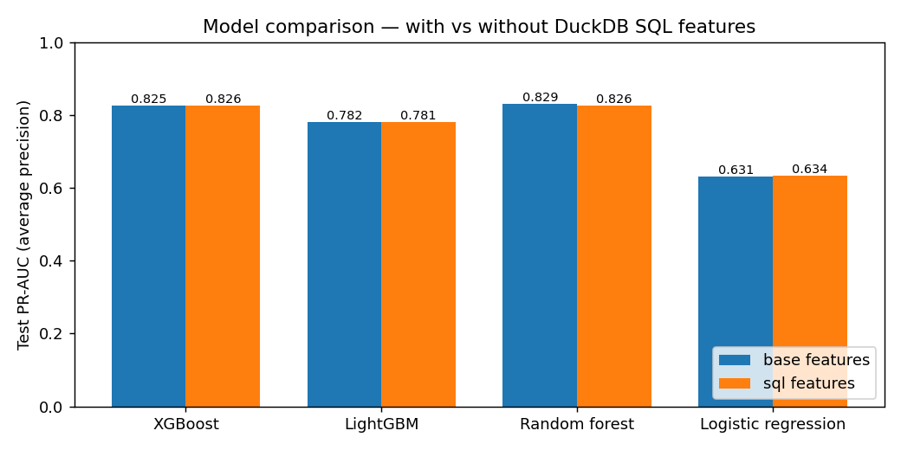

# Model comparison

4 model families x 2 feature sets on the Kaggle credit-card fraud data (stratified 70/15/15 split, deduplicated). Winner selected on **validation PR-AUC**; test columns are the untouched holdout at each model's own tuned threshold (highest precision with recall >= floor).

| Model | Features | Val PR-AUC | Test PR-AUC | Test ROC-AUC | Test recall | Test precision | Test F1 |
|---|---|---|---|---|---|---|---|
| XGBoost **(best)** | base | 0.865 | 0.825 | 0.972 | 0.831 | 0.584 | 0.686 |
| XGBoost **(best)** | sql | 0.869 | 0.826 | 0.975 | 0.831 | 0.656 | 0.733 |
| LightGBM | base | 0.845 | 0.782 | 0.969 | 0.803 | 0.606 | 0.691 |
| LightGBM | sql | 0.855 | 0.781 | 0.967 | 0.817 | 0.468 | 0.595 |
| Random forest | base | 0.861 | 0.829 | 0.954 | 0.817 | 0.906 | 0.859 |
| Random forest | sql | 0.861 | 0.826 | 0.953 | 0.817 | 0.866 | 0.841 |
| Logistic regression | base | 0.727 | 0.631 | 0.970 | 0.803 | 0.640 | 0.713 |
| Logistic regression | sql | 0.721 | 0.634 | 0.973 | 0.803 | 0.626 | 0.704 |

